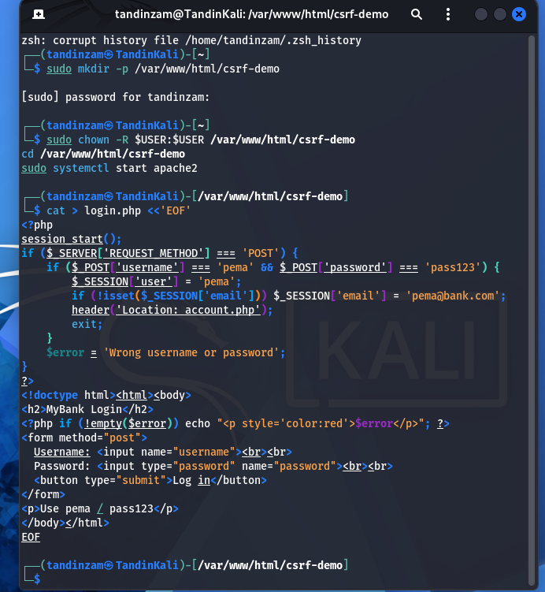
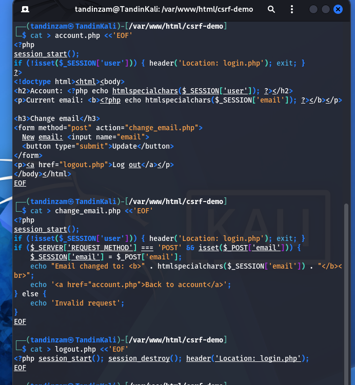
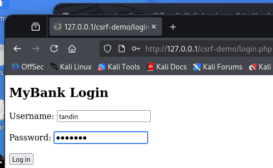
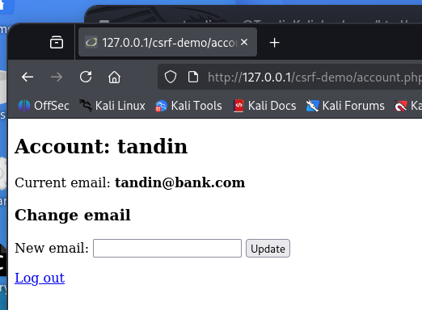
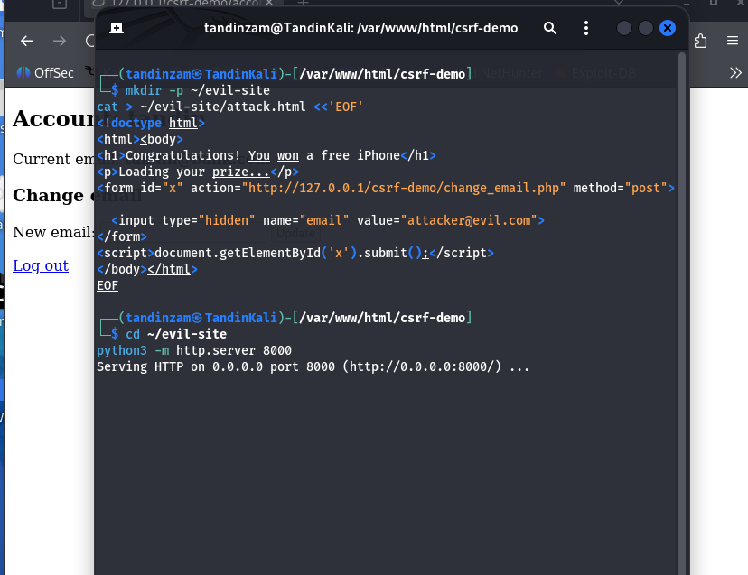
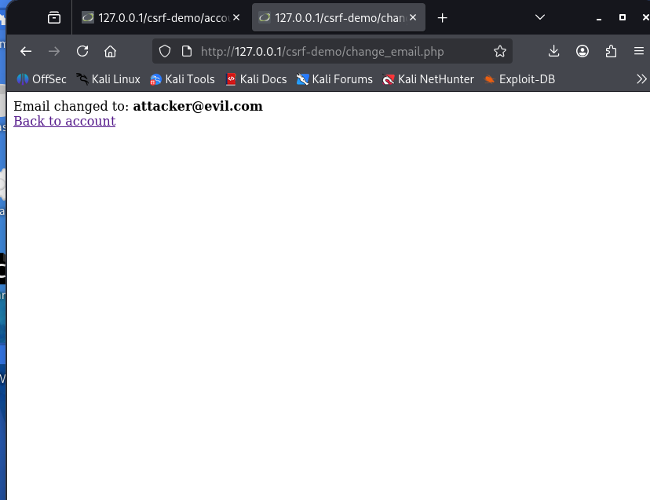
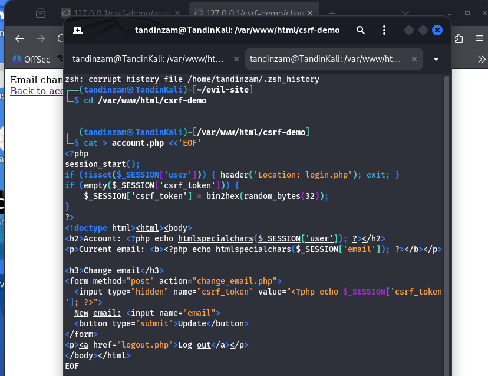
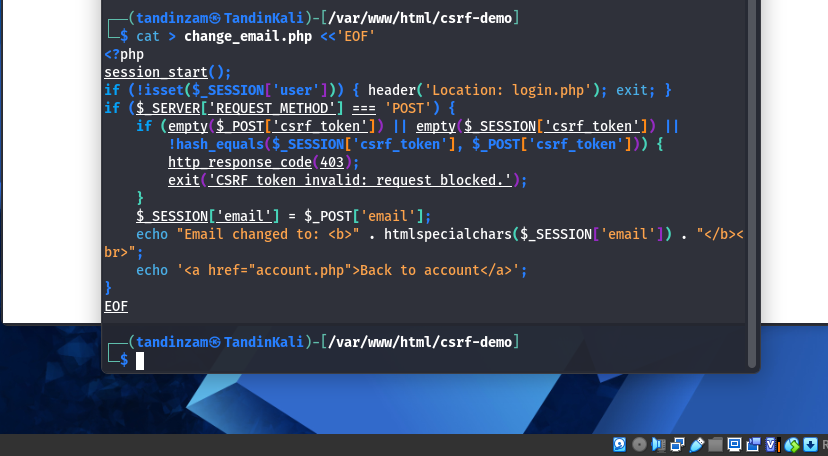
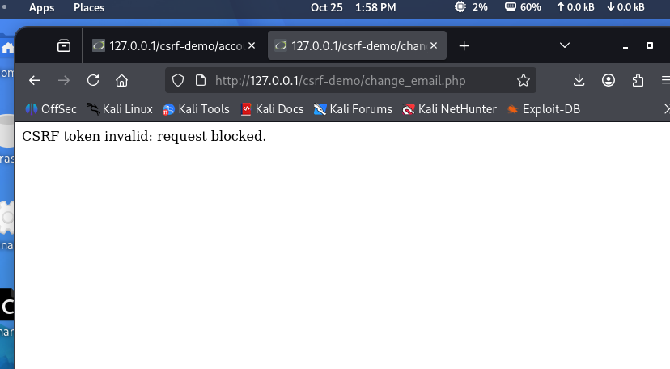

# Lab Report: Cross Site Request Forgery (CSRF) and Token Protection

## Objective

The aim of this lab was to understand how a Cross Site Request Forgery (CSRF) attack works and how a CSRF token stops it. To show this clearly I built a small web application with a sensitive action (changing the account email), attacked it from a separate malicious page, and then added a CSRF token to the same application and ran the exact same attack again to confirm it was blocked.

## Tools Used

- Kali Linux running on VirtualBox
- Apache web server with PHP for the target application
- Python built in HTTP server to host the attacker page on a separate port
- Firefox browser

## Background

CSRF is an attack where a logged in user is tricked into sending a request they did not intend to send. The reason it works is that a browser automatically attaches the user's session cookie to any request going to a site, even when that request is triggered by a different website. So if a user is logged into their bank and then visits a malicious page, that page can quietly send a request to the bank and the browser will attach the user's session, making the request look genuine.

A CSRF token is the standard defense. The server puts a secret random value into its own forms and checks that the same value comes back with every sensitive request. A malicious page cannot read this value because the browser's same origin policy stops one website from reading the contents of another website's page. So the forged request arrives without a valid token and the server rejects it.

## Setup

I created a small application in /var/www/html/csrf-demo with four files. A login page to start a session, an account page that shows the current email and has a form to change it, a script that performs the email change, and a logout page. The login uses one hardcoded account since the app only exists to demonstrate CSRF and does not need a real user database.





I started Apache and opened the login page in Firefox, then logged in. The account page showed the current email as tandin@bank.com and a form to change it.





## Part 1: The Vulnerable Version

In the first version the change email script simply trusted any POST request that came with a valid session. It did not check where the request came from. I confirmed the form worked normally by changing the email through the page itself.

To attack it I built a separate page called attack.html and hosted it on port 8000 using Python, so it acted as a completely separate website from the target. The page showed a fake "you won a free iPhone" message, but it also contained a hidden form that automatically submitted a request to the change email script, setting the email to attacker@evil.com.



While still logged in as tandin, I opened the attacker page in the same browser. The hidden form submitted on its own, the browser attached my session cookie, and the email was changed without me ever touching the real site.



This is the full attack. A page on another origin managed to change my account email. In a real application this is serious because once the attacker controls the email, they can request a password reset and take over the account.

## Part 2: Adding the CSRF Token

To fix the problem I made two changes. The account page now generates a random token when the session starts and places it inside the form as a hidden field. The change email script now checks that token before doing anything, and rejects the request if it is missing or wrong. The check uses a timing safe comparison:

```php
if (empty($_POST['csrf_token']) || empty($_SESSION['csrf_token']) ||
    !hash_equals($_SESSION['csrf_token'], $_POST['csrf_token'])) {
    http_response_code(403);
    exit('CSRF token invalid: request blocked.');
}
```





After updating both files I reloaded the account page once so the new token was issued into my session.

## Part 3: Running the Attack Again

I then opened the exact same attacker page again, with the same logged in session. This time the request was rejected and the server returned a 403 with the message "CSRF token invalid: request blocked".



The only thing that changed between the two runs was the token. The attacker page could not include a valid token because it cannot read the value out of my account page, so the forged request was stopped. I also confirmed that the normal form on the account page still worked, since it carries the real token.

## Observation

| Version | Attack result |
|---------|---------------|
| No CSRF token | Email changed to attacker@evil.com |
| CSRF token added | Request blocked with 403 |

The same attack that succeeded in the first version failed completely once the token was in place, while normal use of the site was not affected.

## Conclusion

This lab showed that CSRF works by abusing the fact that browsers send session cookies automatically, and that switching to POST or relying on the user being logged in does not protect against it. The real defense is a CSRF token, because it is a secret the server controls and the attacker cannot read or guess. Adding a token to the sensitive form and checking it on the server blocked the attack while keeping the application working normally.

## Note on SameSite cookies

Modern browsers also add some protection through SameSite cookies, which block many cross site requests by default. This is useful as an extra layer but it is not a complete fix on its own, since it does not protect against same site attackers such as a malicious subdomain and its behavior can differ between browsers. The CSRF token is the reliable defense that the application itself controls.
